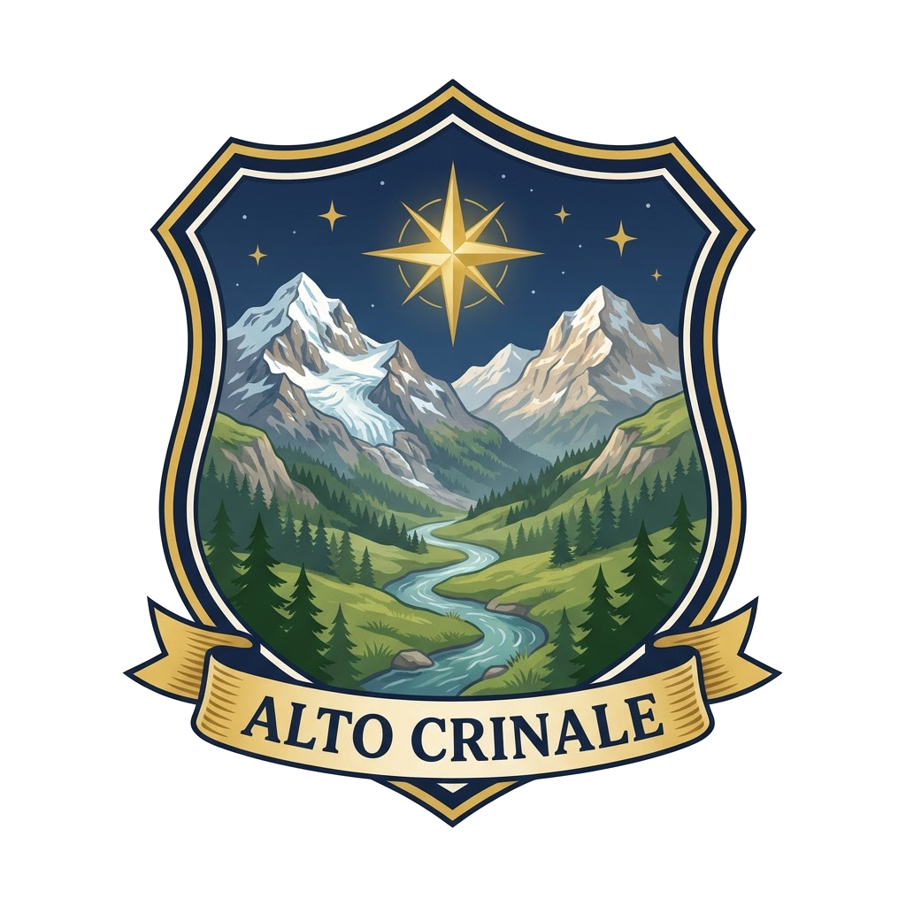
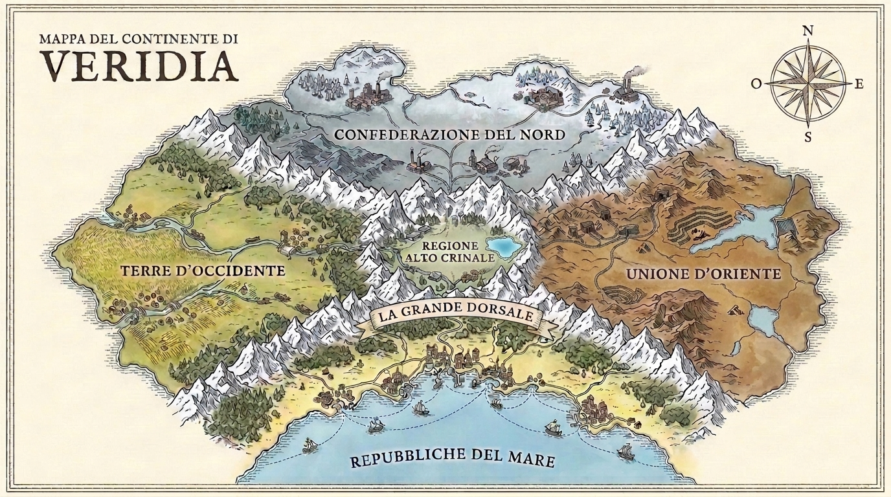
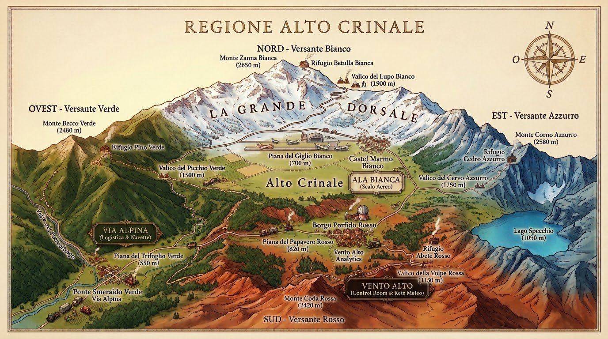
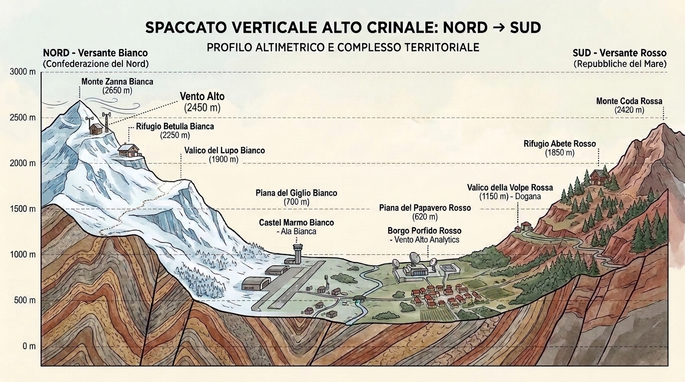
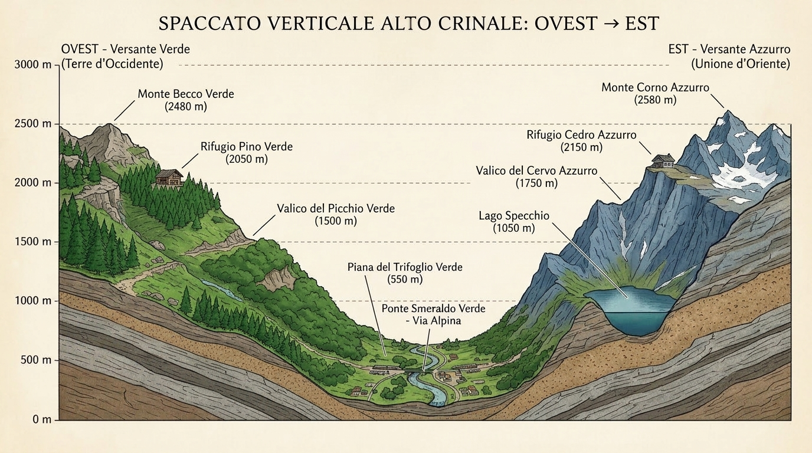
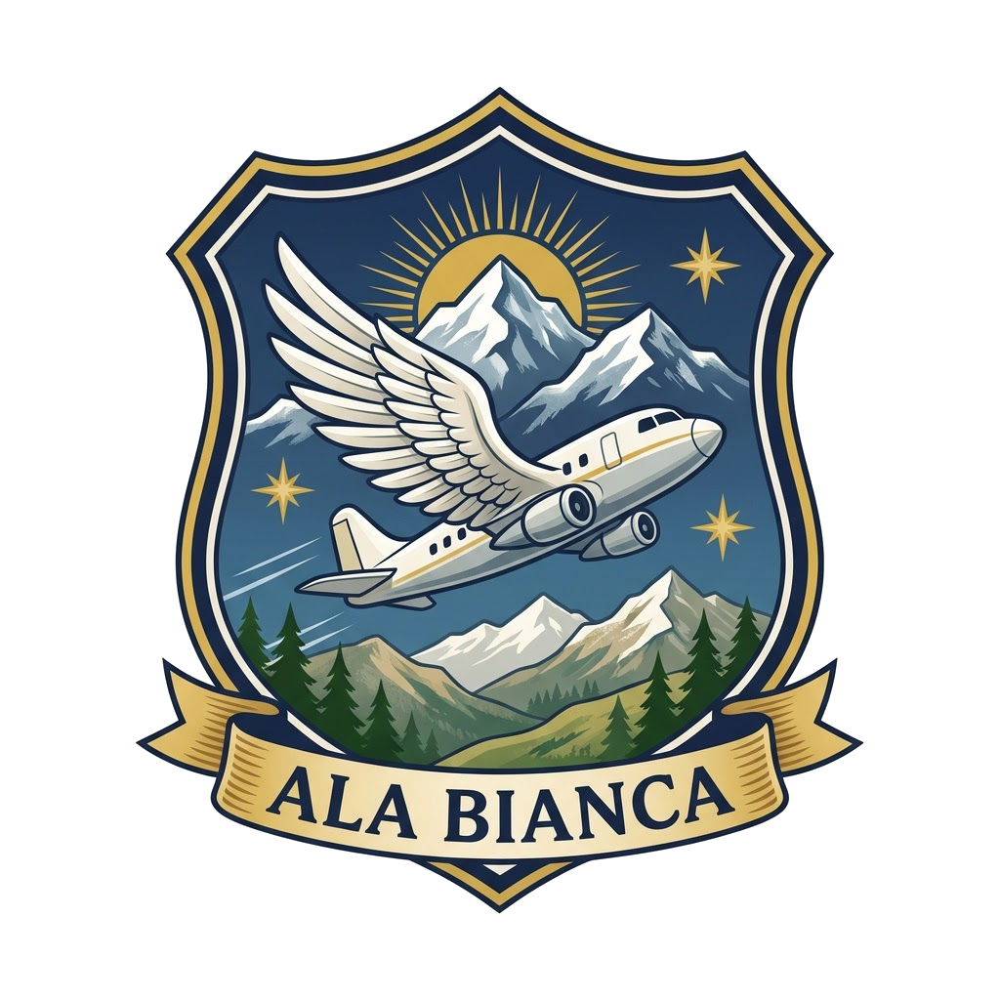
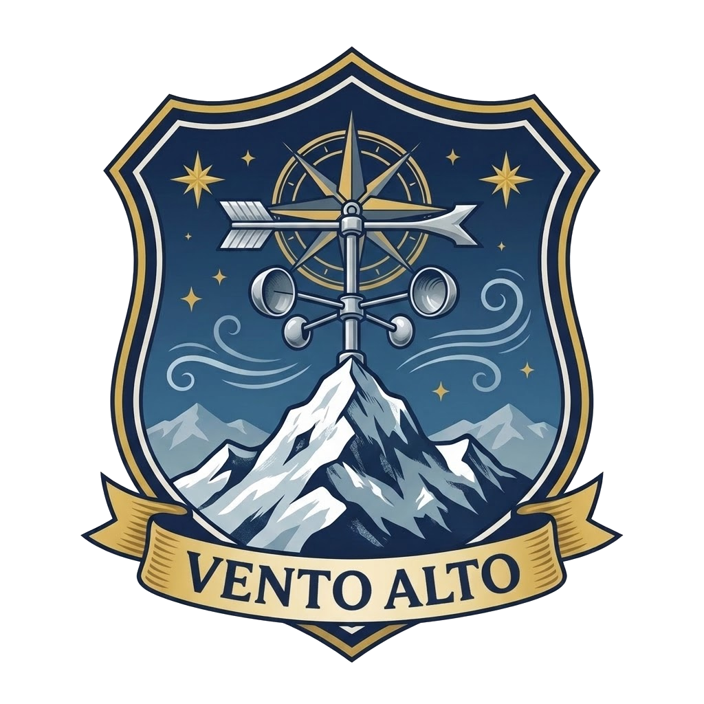
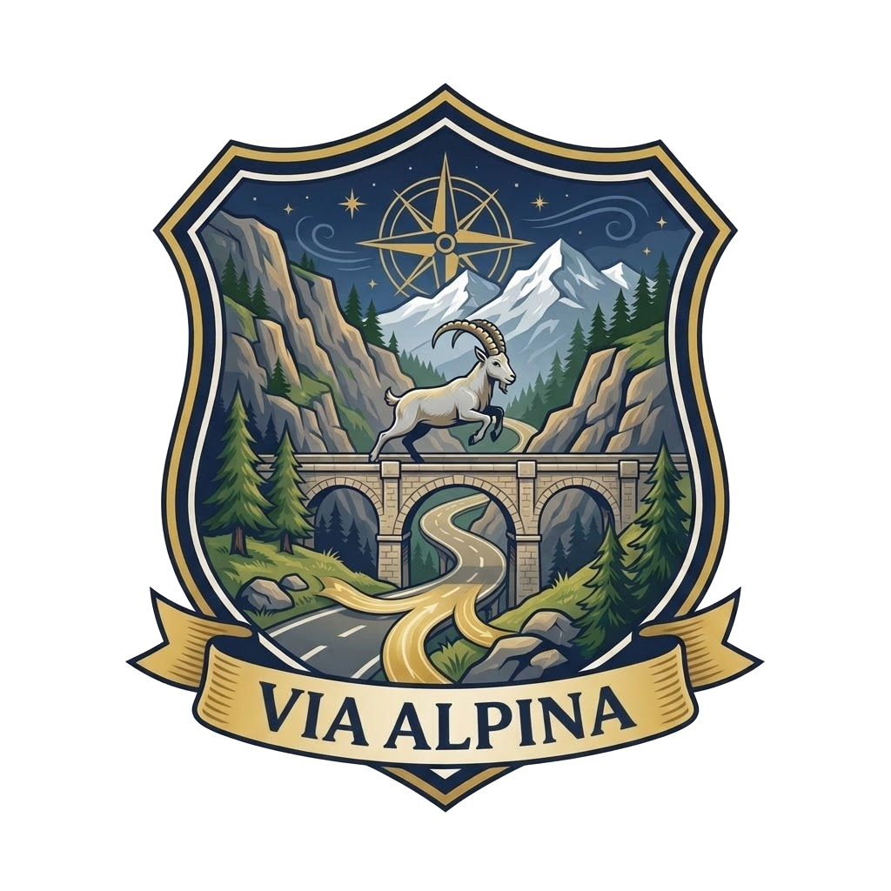

# Cronache della Regione Alto Crinale

*La storia in cinque puntate di una piccola regione montana di confine diventata polo industriale, logistico e turistico internazionale.*

Nel cuore del continente di **Veridia**, proprio nel punto in cui quattro grandi civiltà si sfiorano senza mai toccarsi direttamente, si estende la **Regione Alto Crinale**. A separare il mondo conosciuto corre per centinaia di chilometri la **Grande Dorsale**: una muraglia titanica di creste affilate, pareti verticali e nevi eterne che taglia il continente da parte a parte, dividendo climi, lingue ed economie. Per gran parte della sua lunghezza la catena è un muro invalicabile; ma proprio al centro di Veridia, la montagna allenta la presa e si apre in un grande anfiteatro naturale, custodendo l'unico varco praticabile dell'intero massiccio.

Per secoli, chiunque volesse portare il ferro del Nord verso i porti del Sud, o i minerali d'Oriente verso i mercati d'Occidente, era costretto a passare da qui: attraverso i quattro valichi e le tre piane di **Alto Crinale**. È proprio questa pressione continua dei quattro confini ad aver plasmato la valle, spingendo cielo (**Ala Bianca**), creste (**Vento Alto**) e tornanti (**Via Alpina**) a crescere insieme generazione dopo generazione, senza mai distruggere ciò che aveva già imparato a funzionare, ma costruendo ogni innovazione *a lato* della tradizione.

Nello specifico, attorno a questo crocevia naturale si affacciano i quattro grandi stati di Veridia, ciascuno con un'anima profondamente diversa e bisognosa delle altre:

A **nord** si stende la **Confederazione del Nord**, una terra austera e laboriosa fatta di città operose, officine meccaniche e fonderie che lavorano il ferro e l'acciaio sotto cieli spesso grigi, spinte dal bisogno costante di far viaggiare i propri manufatti verso i mari meridionali.

A **sud** si aprono le **Repubbliche del Mare**, un mosaico di città portuali luminose, moli affollati e rotte commerciali che portano verso l'entroterra merci d'oltremare, spezie e manufatti preziosi.

A **ovest** il paesaggio si distende nelle **Terre d'Occidente**, tra sterminati campi di grano, fiumi lenti e navigabili e antiche città mercantili dove si concentrano granai, fiere e scambi finanziari.

A **est**, infine, si innalzano gli altopiani ventosi dell'**Unione d'Oriente**, un territorio severo di miniere profonde, cave di pietra e grandi bacini d'acqua che forniscono energia e materie prime all'intero continente.

 

# Prologo: Morfologia di Alto Crinale

L'anfiteatro di Alto Crinale si legge scendendo dall'anello esterno verso il cuore della valle lungo i **quattro versanti**, ciascuno con la propria progressione **Monte (`> 2400 m`) → Rifugio → Valico → Piana / Lago → Borgo** e il proprio polo operativo. Su tutte e quattro le creste e nei rispettivi rifugi vegliano le stazioni in quota di **Vento Alto**.

  

  
  

## Nord: Il Versante Bianco
È il fronte più freddo e battuto dai venti, affacciato sulle città operose e sulle fonderie settentrionali. Proprio qui, sulla cresta battuta dalle tormente tra **Monte Zanna Bianca** e **Rifugio Betulla Bianca** (`2450 m`), nacque la prima capannina solitaria di **Vento Alto**; mentre nella conca ampia e riparata a fondovalle si è sviluppato lo scalo di **Ala Bianca**.
* **Stato confinante**: **Confederazione del Nord**
* **Monte (`2650 m`)**: **Monte Zanna Bianca**
* **Rifugio (`2250 m`)**: **Rifugio Betulla Bianca**
* **Valico (`1900 m`)**: **Valico del Lupo Bianco**
* **Piana (`700 m`)**: **Piana del Giglio Bianco**
* **Borgo**: **Castel Marmo Bianco**

### Ala Bianca: I Costruttori dello Scalo

Nella **Piana del Giglio Bianco (`700 m`)**, accanto alle case di **Castel Marmo Bianco**, **Ala Bianca** custodisce l'unica conca ampia, piatta e riparata adatta al volo dentro l'intero varco della Grande Dorsale. All'inizio era solo una pista in terra battuta spazzata dalla brina del mattino e una baracca di legno, dove un addetto usciva con la lanterna in mano a controllare il carburante a vista e segnava a penna i movimenti dei piccoli biplani postali su un grande registro rilegato.

Quando la pista raddoppia in una vera aviosuperficie e poi diventa il **gate internazionale di Veridia**, lo scalo non cancella mai ciò che funzionava: affianca ai vecchi registri un archivio centrale, impara a leggere in tempo reale i bollettini di quota di **Vento Alto** anche quando la tormenta disturba le linee e coordina piste, biglietteria e bagagli per i viaggiatori di tutti e quattro gli stati confinanti.

Oggi chi sbarca ad Ala Bianca trova un aeroporto alpino affidabile e aperto al continente, ma cresciuto fedele alla stessa regola del primo giorno: ogni nuova tecnologia è stata costruita *a lato* della precedente, trasformando un piccolo scalo di montagna nella porta aerea più sicura della Grande Dorsale.

## Sud: Il Versante Rosso
È il versante più mite e aperto tutto l'anno, la porta naturale verso i porti meridionali: qui sorge l'antica dogana controllata da **Via Alpina** e qui, nelle Puntate 4–5, **Vento Alto** ha spostato in pianura il proprio **3° polo operativo** (**Vento Alto Analytics**), nella conca più accessibile in ogni stagione.
* **Stato confinante**: **Repubbliche del Mare**
* **Monte (`2420 m`)**: **Monte Coda Rossa**
* **Rifugio (`1850 m`)**: **Rifugio Abete Rosso**
* **Valico (`1150 m`)**: **Valico della Volpe Rossa** *(dogana di frontiera)*
* **Piana (`620 m`)**: **Piana del Papavero Rosso**
* **Borgo**: **Borgo Porfido Rosso**

### Vento Alto: Le Sentinelle della Cresta & Control Room Regionale

La storia di **Vento Alto** inizia in solitudine a `2450 m`, sulla cresta esposta tra il **Monte Zanna Bianca (`2650 m`)** e il **Rifugio Betulla Bianca (`2250 m`)**, dentro una piccola capannina di legno dove un osservatore trascriveva a mano forza del vento e pressione su taccuini cerati prima che la tormenta strappasse i fili del telegrafo. Da quella prima sentinella solitaria è nata una costellazione di cinquanta stazioni alpine distribuite su tutte le **4 cime**, i **4 rifugi** e i **4 valichi** dell'anello montuoso.

Nelle fasi successive, davanti alla piena di milioni di pacchetti radar e serie storiche provenienti da tutta la valle, l'osservatorio compie il salto decisivo: lasciando intatti i sensori sulle creste, scende in pianura nella **Piana del Papavero Rosso (`620 m`)** a **Borgo Porfido Rosso**, aprendo il **3° polo operativo** della regione (**Vento Alto Analytics**).

È qui che la voce delle montagne diventa la **Control Room Regionale**: un unico lago di dati condiviso dove le letture di cielo, creste e tornanti convergono in tempo reale per anticipare nebbie, ghiaccio e chiusure dei valichi, trasformando l'esperienza dell'alta quota nella bussola dell'intera valle.

## Ovest: Il Versante Verde
Tra boschi fitti e tornanti che scendono verso i fiumi e i campi di grano d'Occidente, il torrente della **Valle del Fiumelungo** attraversa la piana più bassa della regione: è il corridoio vitale di **Via Alpina**, che da qui coordina trasporti su gomma verso tutti e quattro i valichi.
* **Stato confinante**: **Terre d'Occidente**
* **Monte (`2480 m`)**: **Monte Becco Verde**
* **Rifugio (`2050 m`)**: **Rifugio Pino Verde**
* **Valico (`1500 m`)**: **Valico del Picchio Verde**
* **Piana (`550 m`)**: **Piana del Trifoglio Verde**
* **Borgo**: **Ponte Smeraldo Verde**

### Via Alpina: I Corrieri della Valle & Control Tower Intermodale

Lungo le acque rapide della **Valle del Fiumelungo** e nella **Piana del Trifoglio Verde (`550 m`)**, con sede operativa a **Ponte Smeraldo Verde**, **Via Alpina** è l'anima terrestre della regione: quella di chi conosce ogni tornante, ogni cambio di pendenza e ogni chiusura improvvisa dei valichi quando scende la neve. Dai primi uffici traffico pieni di schedari di legno, lavagne d'ardesia e bolle timbrate a mano alla dogana del **Valico della Volpe Rossa (`1150 m`)**, i suoi autisti hanno tenuto aperto il passaggio tra i quattro confini anche nei giorni più duri dell'inverno.

Con la crescita della valle, quei viaggi solitari sono diventati una regia intermodale capace di unire merci e persone: le flotte cargo attraversano i quattro valichi incrociando in diretta le allerte di **Vento Alto**, mentre le navette turistiche accompagnano i visitatori fino al **Lago Specchio (`1050 m`)** e ai rifugi in quota.

Oggi la **Control Tower intermodale** di Via Alpina coordina ogni partenza in dialogo continuo e bidirezionale con **Ala Bianca**: ogni carico pronto su gomma orienta le operazioni in pista, e ogni volo in arrivo guida le partenze verso i quattro orizzonti di Veridia.

## Est: Il Versante Azzurro
Sotto le pareti che guardano gli altopiani ventosi d'Oriente, la montagna scende ripida senza lasciare spazio a piane o borghi: al loro posto si apre il **Lago Specchio**, uno specchio d'acqua alpino raggiungibile solo con le navette di **Via Alpina** e osservato dai bollettini pubblici di **Vento Alto**.
* **Stato confinante**: **Unione d'Oriente**
* **Monte (`2580 m`)**: **Monte Corno Azzurro**
* **Rifugio (`2150 m`)**: **Rifugio Cedro Azzurro**
* **Valico (`1750 m`)**: **Valico del Cervo Azzurro**
* **Lago (`1050 m`)**: **Lago Specchio** *(nessuna piana né borgo)*

 

# Genesi: L'Evoluzione di Alto Crinale

La trasformazione di Alto Crinale attraversa **cinque puntate**, dal ritmo lento della carta e del telegrafo fino alla regia condivisa di un polo internazionale. In ogni passaggio vale la stessa regola: **niente di ciò che funziona viene distrutto, tutto cresce a lato dell'esistente**.

## Puntata 1: Carta, Telegrafo e Tormente

Alto Crinale vive al ritmo delle stagioni tra i borghi, i rifugi e la dogana del **Valico della Volpe Rossa**. Senza reti digitali, ogni attività si regge su registri cartacei e sul telegrafo lungo i pali di legno.

* **Ala Bianca** (*Piana del Giglio Bianco*): pista in terra battuta e baracca di legno. Checklist e movimenti di piccoli biplani postali o cargo vengono annotati a mano su registri rilegati; i ritardi si comunicano via telegrafo.
* **Vento Alto** (*cresta tra Monte Zanna Bianca e Rifugio Betulla Bianca, `2450 m`*): una singola capannina meteo con anemometro meccanico e barometro a mercurio. L'osservatore trascrive vento e pressione su taccuini cerati e invia i bollettini a valle via telegrafo o con gli sciatori.
* **Via Alpina** (*Piana del Trifoglio Verde / Ponte Smeraldo Verde*): ufficio traffico tra schedari di legno, lavagne di ardesia e bolle doganali timbrate a mano; gli autisti consegnano posta, merci e medicinali prima che la neve chiuda i passi.

## Puntata 2: I Primi Archivi e la Regola del "Crescere a Lato"

Con la crescita dei traffici tra i quattro confini arrivano i primi cavi telefonici e i primi computer. La regione adotta la regola che guiderà ogni evoluzione successiva: **non distruggere ciò che funziona, ma costruire ogni novità a lato dell'esistente**.

* **Ala Bianca**: la pista raddoppia in aviosuperficie con hangar e torre tra Monte Corno Azzurro e Monte Becco Verde. Al registro cartaceo si affiancano prima un diario digitale su file locali, poi un archivio centrale (`AirfieldDb`) con ponte diretto verso la dogana del Valico della Volpe Rossa.
* **Vento Alto**: la capannina diventa una rete di **cinquanta stazioni alpine** dal Valico del Cervo Azzurro al Valico del Picchio Verde, sostenuta da una memoria relazionale condivisa, un portale per consorzi e soccorsi e la libreria di calcolo `ventoalto-core`.
* **Via Alpina**: depositi, mezzi, autisti e valichi convergono in un archivio vivo (`ViaAlpinaCore`). Gli autisti usano app mobili per prove di consegna geolocalizzate e segnalazioni neve; piccoli automi gestiscono i vecchi programmi doganali e un assistente risponde su limiti di massa e orari dei passi.

## Puntata 3: Quando Cielo, Creste e Tornanti Iniziarono a Parlarsi

Le tre realtà della valle smettono di operare su binari paralleli e iniziano a scambiarsi segnali in tempo reale su contratti chiari e banchi di prova comuni.

* **Vento Alto** espone i bollettini ufficiali tramite servizi sicuri e selettivi: previsioni pubbliche per escursionisti e turisti, allerte ad alta priorità per chi vola o guida sui passi.
* **Ala Bianca** interroga le previsioni di Vento Alto in modo resiliente, proteggendo tabelloni e operazioni sulla Piana del Giglio Bianco anche durante le bufere, con verifiche automatiche prima di ogni rilascio.
* **Via Alpina** integra i bollettini meteo nelle mappe di viaggio e nei flussi dei trasporti straordinari, misura la puntualità reale sulle tratte alpine e apre un portale condiviso per clienti e corrieri partner.

## Puntata 4: Il Trattato di Veridia e l'Era dei Dati

Le quattro nazioni di Veridia firmano il trattato di libero transito, potenziando la dogana del **Valico della Volpe Rossa**. Essendo la **Piana del Giglio Bianco** l'unica conca adatta a uno scalo continentale, **Ala Bianca** diventa **scalo internazionale**.

* **Esplosione dei dati (il 3° Polo in pianura)**: milioni di pacchetti radar, serie storiche delle 50 stazioni e tracciati dei mezzi portano **Vento Alto** (nato a `2450 m`, tra **Monte Zanna Bianca** e **Rifugio Betulla Bianca**) a scendere in pianura nella **Piana del Papavero Rosso (`620 m`)**, a **Borgo Porfido Rosso**: nasce così il **3° polo operativo** di **Vento Alto Analytics**, con un unico **lago di dati condiviso** senza copie inutili, quarantena dei dati corrotti e tavole certificate per i reparti finanziari, le tre città e i cruscotti direzionali.
* **Monitoraggio in Tempo Reale**: i flussi di anemometri e radar arrivano in tempo reale con latenza inferiore al secondo. Al superamento delle soglie di vento laterale o ghiaccio, il sistema attiva automaticamente gli avvisi per piste e tornanti.
* **Previsione**: sulla memoria storica matura vengono addestrati modelli per anticipare nebbia sulla piana, chiusure dei valichi e ritardi lungo le arterie alpine.

## Puntata 5: La Porta di Veridia e la Regia Condivisa

Alto Crinale è ormai un **polo industriale, logistico e turistico internazionale** in cui cielo, montagna e strada operano sotto una regia condivisa, mantenendo intatta la regola del *crescere a lato*.

* **Ala Bianca**: scalo internazionale multilingua con tabelloni live, app per operatori di piazzale funzionanti anche in zone d'ombra radio e dorsale distribuita per piste, biglietteria e bagagli.
* **Via Alpina**: la **centrale operativa intermodale** coordina flotte cargo e navette turistiche (verso il **Lago Specchio** e i rifugi) monitorando il profilo altimetrico dei passi e dialogando **in modo bidirezionale** con lo scalo aereo.
* **Vento Alto & Regia Condivisa**: flussi binari tracciabili alimentano piste e strade, mentre la sala di osservabilità unificata raccoglie in un unico sguardo metriche, tracce e segnali dell'intera valle.
